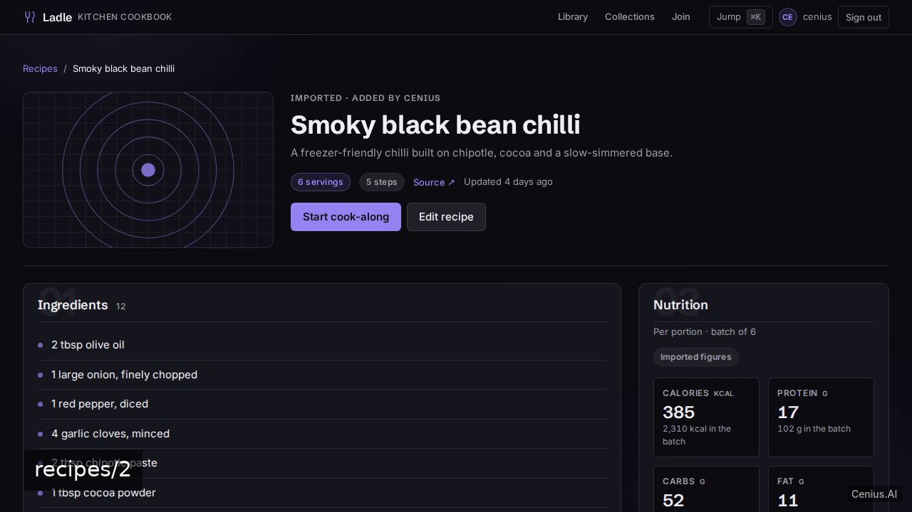
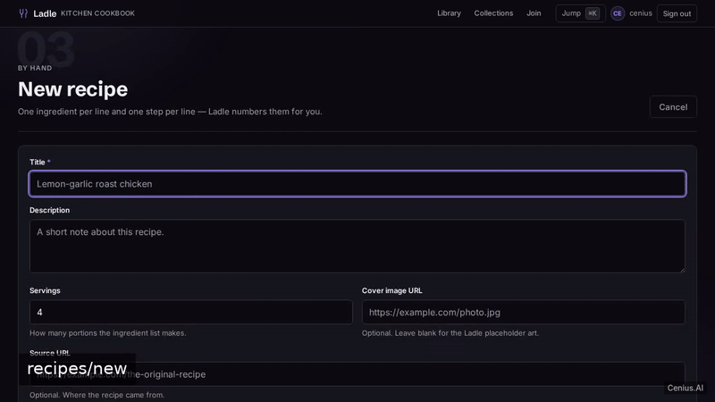
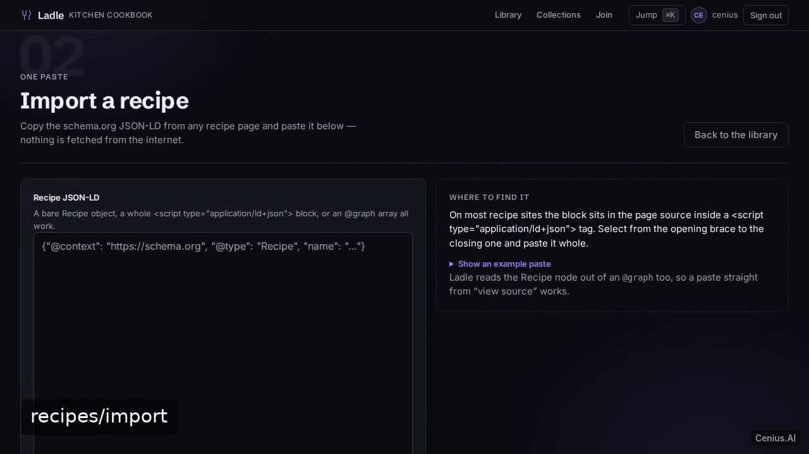
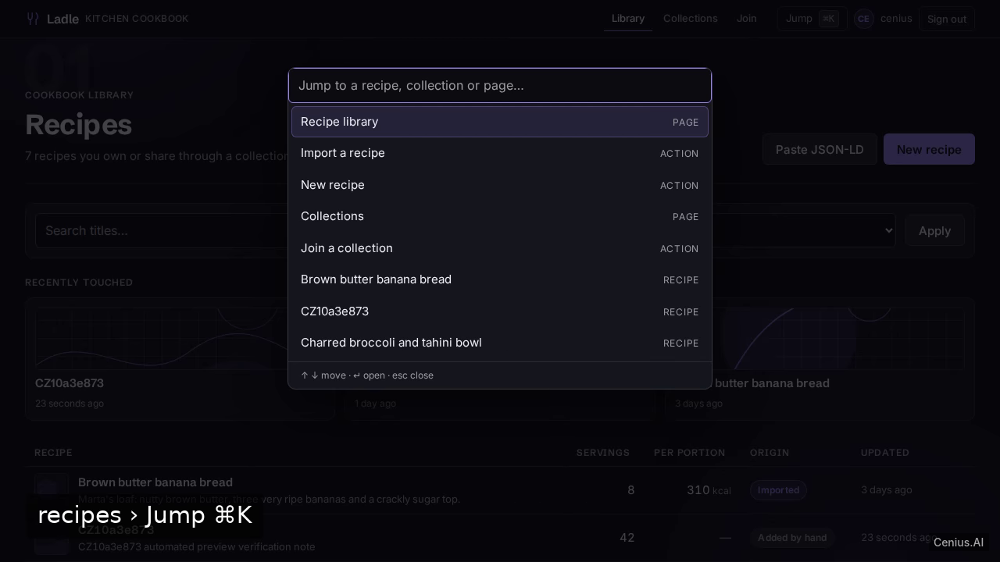
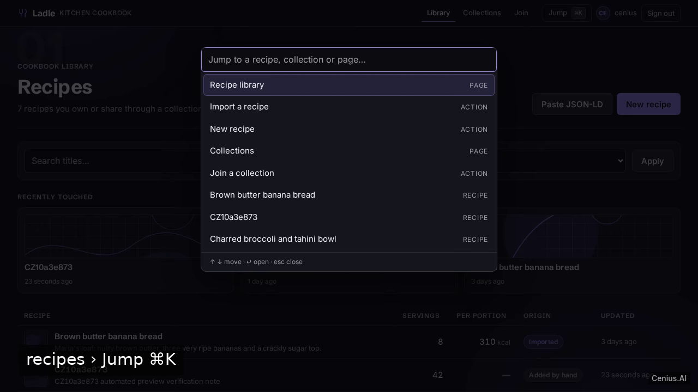

# Ladle Kitchen Cookbook — production-ready Django recipe manager starter

Want to run your own recipe manager without paying for SaaS? **Ladle Kitchen Cookbook** is a free, Apache-2.0-licensed Django project that you can clone and self-host today. Ladle Kitchen Cookbook is a lean, self-hostable Django recipe manager for home cooks. Every Ladle Kitchen Cookbook feature — every screen, every seed record — is here. [Open Ladle Kitchen Cookbook on cenius.ai](https://cenius.ai/marketplace/p/ladle-kitchen-cookbook?ref=gh&utm_campaign=ladle-kitchen-cookbook-django) to modify it without writing code.


[](LICENSE)  [](https://cenius.ai)

[](https://cenius.ai/marketplace/p/ladle-kitchen-cookbook?ref=gh&utm_campaign=ladle-kitchen-cookbook-django)

> **▶ [Open & edit in cenius.ai](https://cenius.ai/marketplace/p/ladle-kitchen-cookbook?ref=gh&utm_campaign=ladle-kitchen-cookbook-django)** — one click to an editable workspace: describe changes in plain English, get an instant preview, one-click deploy and host. Modifications made on the platform come with full rebrand & relicense rights.

_Local clone? See [Quick start](#quick-start) below. cenius.ai is the zero-setup path._

## Demo





📽 **[Watch the walkthrough](https://cenius.ai/marketplace/p/ladle-kitchen-cookbook?ref=gh&utm_campaign=ladle-kitchen-cookbook-django)** — plays on cenius.ai · [MP4 file](.github/media/demo.mp4)

## Screenshots

  

## Quick start

```bash
./install.sh   # installs dependencies + seeds demo data
```

See [`INSTALL.md`](INSTALL.md) for full setup and usage instructions.

## Architecture

Django project, delivered as a complete runnable codebase (99 files). Top-level layout: `cookbook/`, `ladle/`, `static/`, `templates/`. The setup script (`install.sh`) installs runtime dependencies and loads a starter dataset so the app is immediately usable. See [`INSTALL.md`](INSTALL.md) for complete setup instructions.

## Features

- Username/email accounts with sign-in and sign-out
- Recipe import by pasting schema.org Recipe JSON-LD
- Recipe library and manual CRUD
- Nutrition totals per portion with manual override
- Cookbook collections shared with household members
- Cook-along mode with voice step paging
- Seed data command and README

## Usage guide

### Overview

This is **Ladle Kitchen Cookbook** — an HTTP API + web UI. This document covers the surface area you can use, with copy-pasteable examples for each entry point. For setup, see `INSTALL.md`.

### Quickstart

After completing the install steps in `INSTALL.md`:

```bash
python manage.py runserver    # start the server
## in another terminal:
curl http://localhost:8000/
```

### Endpoints

Every endpoint below was extracted from the source by the route scanner (Next.js / FastAPI / Flask / Django / Express).

_Full guide: [`USAGE.md`](USAGE.md)_

## FAQ

### What does it take to self-host Ladle Kitchen Cookbook?

Clone this repository and run `./install.sh`, then start the app as described in [`INSTALL.md`](INSTALL.md). Ladle Kitchen Cookbook is fully self-hostable — no external services are required to try it.

### How can I customize Ladle Kitchen Cookbook without editing code?

Non-developers can use [cenius.ai](https://cenius.ai/marketplace/p/ladle-kitchen-cookbook?ref=gh&utm_campaign=ladle-kitchen-cookbook-django) to make changes. Describe your goal in everyday language and the platform delivers an updated, ready-to-run project — zero coding on your part.

### Is it possible to white-label Ladle Kitchen Cookbook for a client?

Absolutely. [Open it on cenius.ai](https://cenius.ai/marketplace/p/ladle-kitchen-cookbook?ref=gh&utm_campaign=ladle-kitchen-cookbook-django) and remix it there — platform modifications come with full rebrand and relicense rights over your derivative, so the result is entirely yours.

### What is Ladle Kitchen Cookbook built with?

Powered by Django. This repo is the real thing — full source, seed data, and all — ready to clone and start up. Highlights include username/email accounts with sign-in and sign-out.

### Is Ladle Kitchen Cookbook free for commercial use?

Yes — it ships under the Apache-2.0 license, which permits commercial use, modification and redistribution. The full text is in [LICENSE](LICENSE).

## License & rebranding

Released under the [Apache License 2.0](LICENSE) (© 2026 Cenius AI) — free for personal and commercial use. The Cenius name/logo are trademarks (see NOTICE).

**Need a customized version?** [Remix this app on cenius.ai](https://cenius.ai/marketplace/p/ladle-kitchen-cookbook?ref=gh&utm_campaign=ladle-kitchen-cookbook-django) — modifications made on the platform come with **full rebrand & relicense rights** over your derivative.

## Built with cenius.ai

This entire application — code, design, seeded demo data — was generated on **[cenius.ai](https://cenius.ai)** from a plain-English description.

- 🚀 [Build your own app on cenius.ai](https://cenius.ai)
- 🎛️ [Remix Ladle Kitchen Cookbook on the marketplace](https://cenius.ai/marketplace/p/ladle-kitchen-cookbook?ref=gh&utm_campaign=ladle-kitchen-cookbook-django) — open it in a workspace, prompt for changes, and ship your own version.

More open-source apps: [the Cenius-ai catalog](https://github.com/Cenius-ai) · [showcase index](https://github.com/Cenius-ai/showcase)
